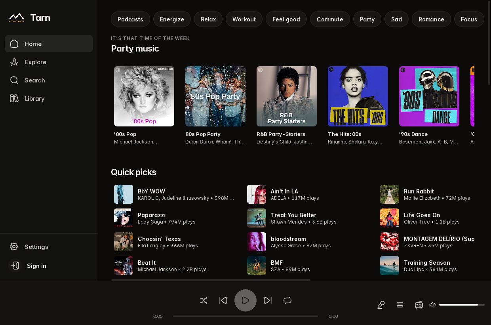
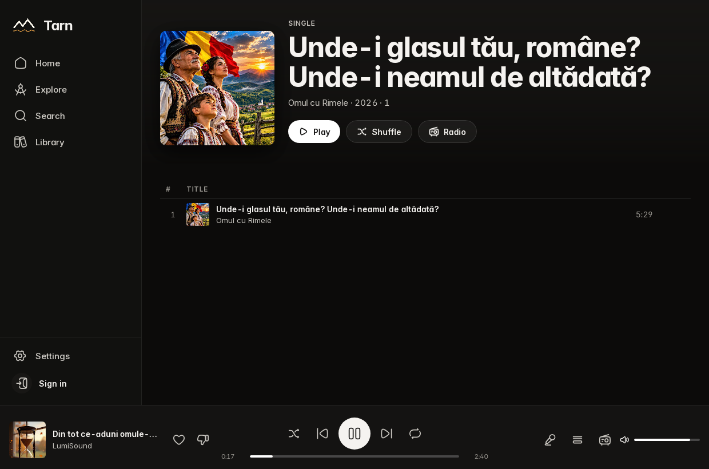

# Tarn

A fast YouTube Music desktop client. Built with Tauri 2, Rust, and Svelte. Works with or without a Google account.

<p align="left"></p>




## Install

Downloads are on the [releases](https://github.com/rexsystems/tarn/releases) page: AppImage, rpm and deb for Linux, NSIS/MSI for Windows, dmg for macOS.

Tarn is self-contained. You do not need to install ffmpeg, yt-dlp, or any other extra tools — audio is decoded in-process, and a current yt-dlp is bundled and updated automatically.

Closing the app remembers the current track and position (paused, ready to play), the queue, volume, shuffle and repeat, the page you were on, and the window size and position.

## Build

Rust 1.77+, Node 20+, and (on Linux) the Tauri system libraries:

```
# Fedora
sudo dnf install webkit2gtk4.1-devel gtk3-devel libappindicator-gtk3-devel librsvg2-devel patchelf openssl-devel alsa-lib-devel

# Debian / Ubuntu
sudo apt install libwebkit2gtk-4.1-dev libgtk-3-dev libayatana-appindicator3-dev librsvg2-dev patchelf libssl-dev libasound2-dev
```

```
npm install
npm run tauri build
```

Packages land in `src-tauri/target/release/bundle/`. For a dev session: `npm run tauri dev`.

The build downloads an official [yt-dlp](https://github.com/yt-dlp/yt-dlp) sidecar automatically; ffmpeg is not used. End users of the packages don't need either.

## License

[GPL-3.0](LICENSE)
